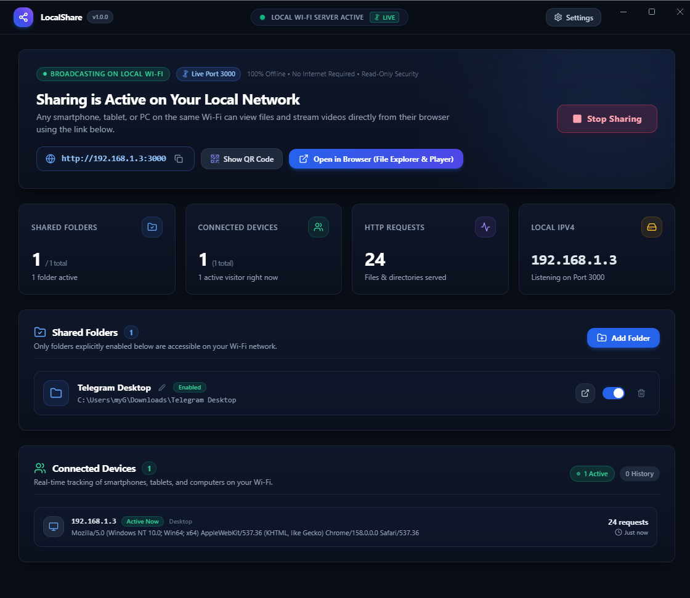
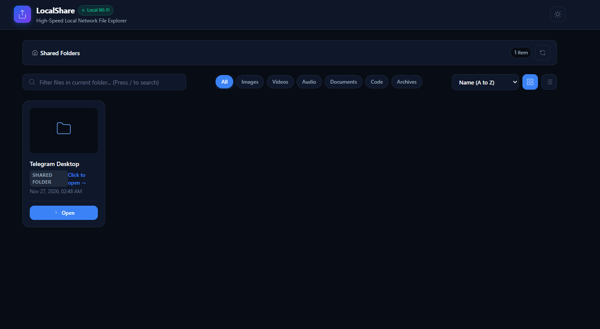
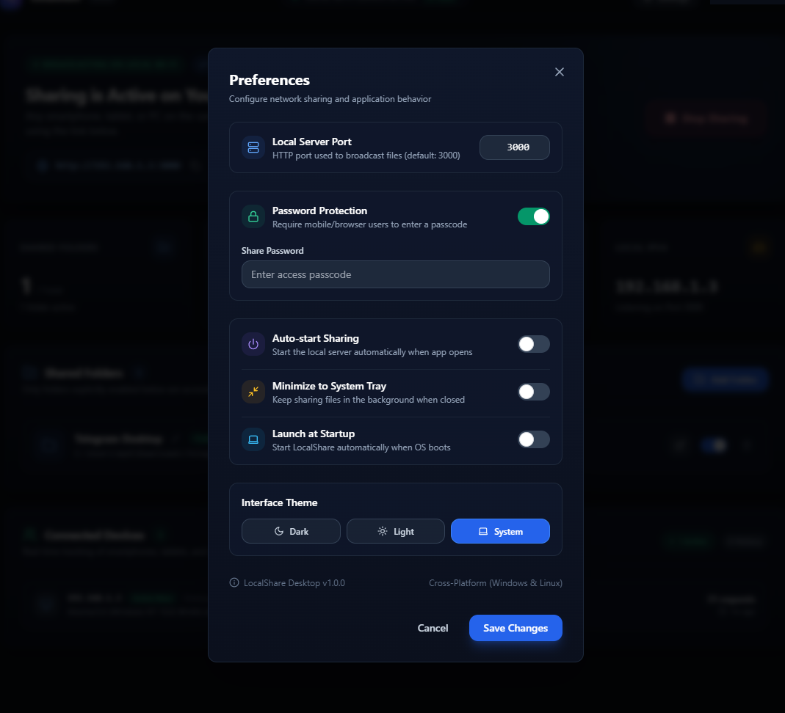

# LocalShare

> Fast, private local Wi-Fi file sharing and media streaming across all your devices.

## About the Project

LocalShare turns your computer into a secure local file server. It lets you share files and stream videos to any phone, tablet, or laptop on the same Wi-Fi network without using the internet or cloud storage.

## Features

- **100% Offline Sharing**: Works entirely over your local Wi-Fi network with zero cloud or internet dependencies.
- **Selective Folder Sharing**: Only share the specific folders you choose from your computer.
- **In-Browser Media Player**: Stream videos directly with seek controls, playback speed, subtitles, and picture-in-picture mode.
- **QR Code Access**: Scan a QR code on your mobile device to open shared files instantly.
- **Fast HTTP 206 Streaming**: Smooth seeking and instant playback for large video and audio files.
- **Safe & Secure**: Read-only protection, directory traversal defense, and optional passcode access.
- **Live Device Tracking**: See connected devices and visitor activity in real time.

## Tech Stack

- **Desktop Host**: Electron, Next.js, React, Tailwind CSS
- **Web Client**: Preact, TypeScript, esbuild
- **Server Engine**: Node.js HTTP Server, HTTP 206 Range Streaming
- **Language**: TypeScript

## Getting Started

### Prerequisites

- [Node.js](https://nodejs.org/) (version 18 or higher)
- npm (included with Node.js)

### 1. Clone the repository

```bash
git clone [repository-url]
cd fileshare
```

### 2. Install dependencies

```bash
npm install
```

### 3. Build the application

```bash
npm run build
```

### 4. Run the desktop app

```bash
npm start
```

### 5. Package for Windows (Optional)

```bash
npm run dist:win
```

## Usage

1. Open **LocalShare** on your computer.
2. Click **Add Folder** to choose a directory you want to share.
3. Click **Start Sharing** to activate the local server.
4. Open the sharing URL (e.g., `http://192.168.1.5:3000`) or scan the QR code from another device on the same Wi-Fi.
5. Browse files, download documents, or click **Preview** on any video to stream it.

## Screenshots / Demo

### Desktop Dashboard


### Web Client & File Explorer


### Settings & Preferences


- **Live Demo**: [None / Local network application]

## Contributing

Contributions are welcome! If you want to contribute:

1. Fork the repository.
2. Create your feature branch (`git checkout -b feature/AmazingFeature`).
3. Commit your changes (`git commit -m 'Add some AmazingFeature'`).
4. Push to the branch (`git push origin feature/AmazingFeature`).
5. Open a Pull Request.

## License

This project is licensed under the **MIT License** - see the [LICENSE](LICENSE) file for details.

## Contact / Author

- **Author**: Rahul O R
- **GitHub**: [[Your GitHub Profile](https://github.com/rahul0070050)]
- **LinkedIn**: [[Your LinkedIn Profile](https://www.linkedin.com/in/rahul-or/)]